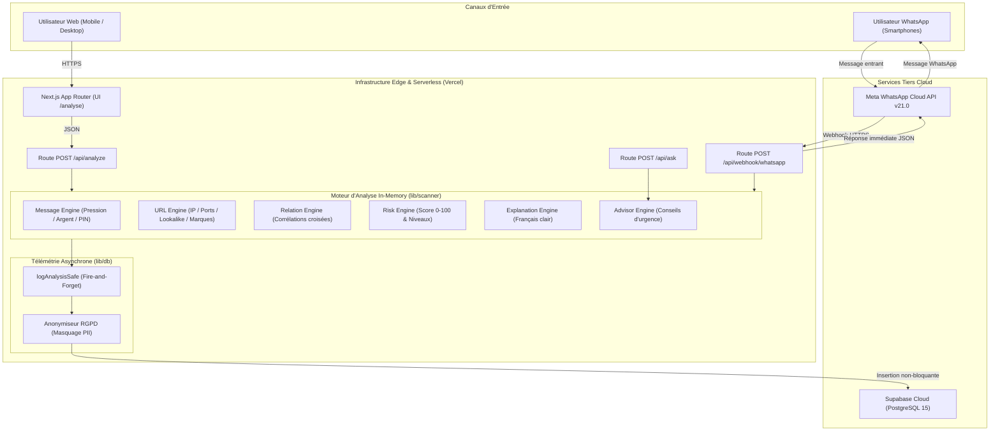

# ⚙️ Document d'Exigences Techniques (TRD — Technical Requirements Document)
## Projet : SecureLink Architecture & Engineering
**Version :** 1.0.0  
**Statut :** Approuvé / En production  
**Date de révision :** Octobre 2026  

---

## 1. Vue d'Ensemble de l'Architecture Système

L'architecture de SecureLink est conçue selon un paradigme **Serverless, découplé et tolérant aux pannes (Fault-Tolerant)**.
Pour garantir une viabilité financière totale (0€ de coût récurrent en phase d'amorçage) et éliminer tout goulot d'étranglement réseau (anciennement Railway), l'ensemble du moteur d'analyse s'exécute **directement en mémoire** dans le runtime Next.js.



---

## 2. Stack Technologique Détaillée

| Composant | Technologie Choisie | Rationale Technique & Avantages |
| :--- | :--- | :--- |
| **Framework Web** | Next.js 16.3.3 (App Router) | Rendu hybride (Server Components + Client), optimisation d'images et bundle ultra-léger. |
| **Langage & Typage** | TypeScript 5.x | Typage strict de tous les signaux, relations et payloads, éliminant les erreurs d'exécution. |
| **Design & UI** | Tailwind CSS v4, Lucide Icons | Styles utilitaires sans surcoût de runtime, dark mode natif et ergonomie mobile. |
| **Hébergement & CDN** | Vercel Serverless Functions | Déploiement continu via GitHub, CDN multi-régions mondial, mise à l'échelle automatique de 0 à des millions de requêtes sans serveur à gérer. |
| **Moteur d'Analyse** | In-Process TypeScript (`lib/scanner`) | Latence de calcul < 15 ms, zéro dépendance envers un serveur Python externe, 0€ de coût. |
| **Base de Données** | Supabase (PostgreSQL 15) | Connexion pooling RESTful via `@supabase/supabase-js`, conformité SQL, Row Level Security (RLS) et requêtes JSONB ultra-rapides. |
| **Passerelle WhatsApp** | Meta Graph API v21.0 | Intégration directe Cloud API officielle, sans passer par un intermédiaire payant (Twilio / MessageBird). |
| **Télémétrie Web** | `@vercel/analytics` & `@vercel/speed-insights` | Monitoring des performances réelles (Core Web Vitals) et des visiteurs sans cookies intrusifs. |

---

## 3. Spécifications des Protocoles & Interfaces API

### 3.1 `POST /api/analyze` (Analyse Web)
- **Entrée :**
  ```json
  { "content": "URGENT Votre compte MTN MoMo est bloqué : http://momo-fake.cm" }
  ```
- **Sortie :** Structure normalisée `AnalysisResult` (Score 0-100, Niveau de risque, Signaux, Relations, Explications, Actions recommandées).
- **Temps de réponse cible :** < 35 ms.

### 3.2 `POST /api/ask` (Conseiller Sécurité)
- **Entrée :**
  ```json
  {
    "question": "J'ai cliqué sur le lien que dois-je faire ?",
    "context": { "risk_level": "Critical", "risk_score": 86 }
  }
  ```
- **Sortie :**
  ```json
  { "answer": "### 🚨 Que faire immédiatement si vous avez cliqué sur le lien : \n1. Fermez la page..." }
  ```

### 3.3 `POST /api/webhook/whatsapp` (Réception WhatsApp Meta)
- **Protocole :** Webhook HTTPS conforme Meta Cloud API.
- **Délai d'accusé de réception :** Réponse HTTP 200 `{"status": "ok"}` envoyée à Meta sous **3 secondes** (requis par l'accord de niveau de service Meta pour éviter les re-tentatives en boucle).

---

## 4. Sécurité, Cryptographie & Conformité PII

### 4.1 Moteur d'Anonymisation des Données (`lib/db/anonymizer.ts`)
Avant tout enregistrement en base de données, le contenu subit une désensibilisation irréversible via expressions régulières compilées :
- **Numéros de téléphone camerounais** (`+237...`, `6XXXXXXXX`, `2XXXXXXXX`) ➔ Remplacés par `[TÉLÉPHONE MASQUÉ]`.
- **Numéros de téléphone internationaux** ➔ Remplacés par `[TÉLÉPHONE MASQUÉ]`.
- **Cartes bancaires (16 chiffres)** ➔ Remplacées par `[CARTE BANCAIRE MASQUÉE]`.
- **Identifiants IBAN** ➔ Remplacés par `[IBAN MASQUÉ]`.
- **Adresses Email** ➔ Remplacées par `[EMAIL MASQUÉ]`.

### 4.2 Protection de la Base de Données (Row Level Security - RLS)
La table `analyses` sur Supabase est protégée par RLS :
- Insertion autorisée pour le client anonyme de l'application via des politiques strictes (`CHECK (true)`).
- Lecture réservée aux administrateurs ou requêtes d'agrégation sécurisées.

---

## 5. Gestion de la Concurrence & Modèle "Fire-and-Forget"

Pour garantir un taux de disponibilité de 99.99% :
1. L'appel `logAnalysisSafe` est découplé de la chaîne de réponse utilisateur.
2. La fonction retourne immédiatement le verdict d'analyse au client Web ou au bot WhatsApp.
3. L'écriture en base de données s'exécute dans une promesse asynchrone isolée avec bloc `try/catch`.
4. En cas de panne de base de données, de latence réseau ou de dépassement temporaire, **aucune erreur n'est remontée à l'utilisateur final**.

---

## 6. Variables d'Environnement Requises

| Variable | Description | Emplacement |
| :--- | :--- | :--- |
| `NEXT_PUBLIC_SUPABASE_URL` | URL de l'instance Supabase Cloud | Vercel & `.env.local` |
| `NEXT_PUBLIC_SUPABASE_ANON_KEY` | Clé publique anonyme Supabase | Vercel & `.env.local` |
| `WHATSAPP_TOKEN` | Token permanent du System User Meta | Vercel & `.env.local` |
| `WHATSAPP_PHONE_NUMBER_ID` | Identifiant du numéro WhatsApp officiel (`1483345801519471`) | Vercel & `.env.local` |
| `WHATSAPP_VERIFY_TOKEN` | Token de vérification du Webhook Meta | Vercel & `.env.local` |
| `GEMINI_API_KEY` *(Optionnel)* | Clé Google AI pour réponses IA génératives | Vercel & `.env.local` |
| `VIRUSTOTAL_API_KEY` *(Optionnel)* | Clé VirusTotal pour détection mondiale | Vercel & `.env.local` |
| `URLHAUS_API_KEY` *(Optionnel)* | Clé URLhaus pour détection malware | Vercel & `.env.local` |
