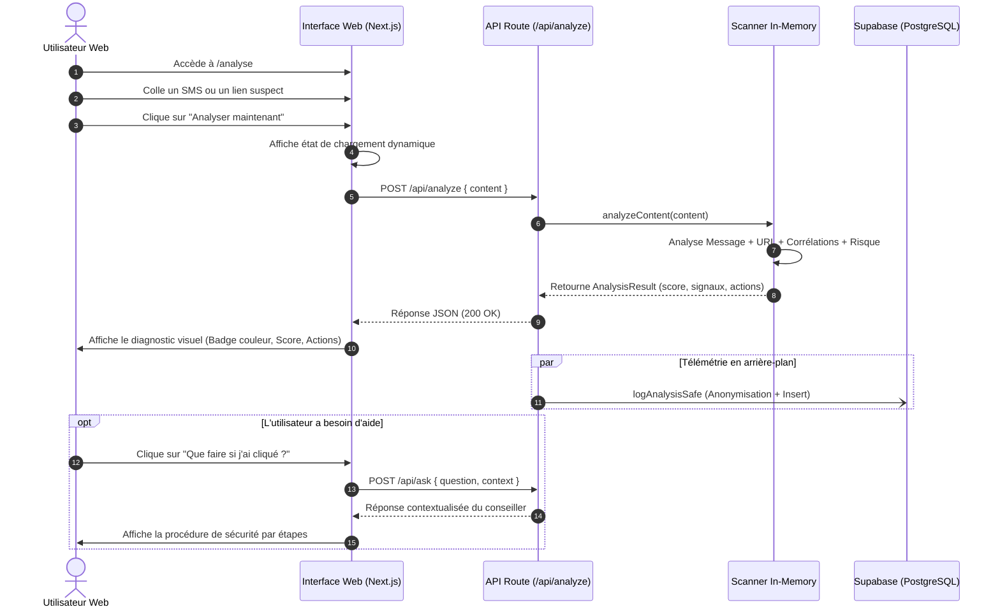
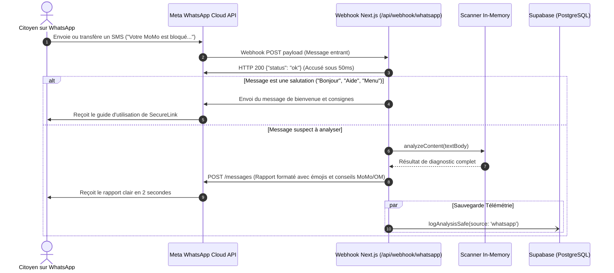
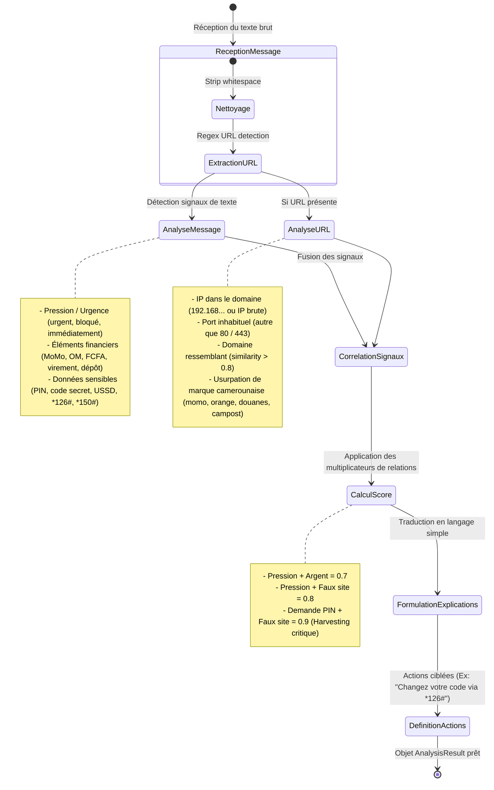

# 🔄 Document de Flux Applicatif (Appflow & Parcours Système)
## Projet : SecureLink User Journeys & State Transitions
**Version :** 1.0.0  
**Statut :** Approuvé / En production  
**Date de révision :** Octobre 2026  

---

## 1. Vue d'Ensemble des Parcours

SecureLink propose deux points d'accès complémentaires adaptés aux réalités africaines :
1. **L'application Web (`/` et `/analyse`)** : Idéale pour les analyses approfondies, avec interface riche, visualisations, conseiller interactif et signalement communautaire.
2. **Le Bot WhatsApp (`+237 6 56 73 13 63`)** : Conçu pour l'usage quotidien instantané, accessible à 100% de la population sur smartphone sans rien installer.

---

## 2. Parcours Utilisateur Web

---

## 3. Parcours Utilisateur WhatsApp

---

## 4. Machine à États du Moteur d'Analyse (Pipeline Interne)

---

## 5. Gestion des Cas Limites (Edge Cases)

| Cas Limite | Détection | Comportement Système |
| :--- | :--- | :--- |
| **Texte vide ou espaces uniquement** | `content.trim().length === 0` | Retourne HTTP 400 avec message amical : *"Veuillez coller un texte ou un lien à vérifier."* |
| **URL malformée ou incomplète** (ex: `https://:8080`) | Analyseur URL échoue | Génère le signal `malformed_url` avec score modéré pour avertir l'utilisateur de la syntaxe anormale. |
| **Message WhatsApp non-textuel** (audio, image, vidéo) | `message.type !== "text"` | Répond poliment : *"SecureLink analyse actuellement les messages textes, SMS et liens. Envoyez-moi le texte du message."* |
| **Tentative de spam ou d'inondation** | Plus de 30 requêtes/minute | Le rate-limiter protège l'application et renvoie un statut HTTP 429 temporaire. |
| **Coupure réseau de la base de données** | Supabase injoignable | L'analyseur s'exécute quand même, répond à l'utilisateur sans aucune interruption (Fail-Safe), et logue un avertissement silencieux. |
