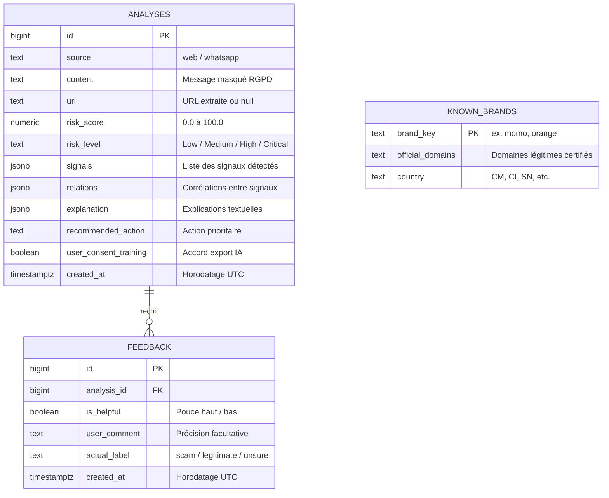

# 🗄️ Document d'Architecture Backend & Schéma de Données
## Projet : SecureLink Database & API Data Contract
**Version :** 1.0.0  
**Statut :** Approuvé / En production  
**Date de révision :** Octobre 2026  

---

## 1. Modèle Entité-Association (ERD)



---

## 2. Définition SQL Complète (DDL PostgreSQL — Supabase)

```sql
-- 1. Table principale de stockage des analyses (Dataset Startup)
CREATE TABLE IF NOT EXISTS public.analyses (
    id BIGINT GENERATED BY DEFAULT AS IDENTITY PRIMARY KEY,
    source TEXT NOT NULL DEFAULT 'web' CHECK (source IN ('web', 'whatsapp', 'api', 'system_test')),
    content TEXT NOT NULL,
    url TEXT,
    risk_score NUMERIC(5,2) NOT NULL CHECK (risk_score >= 0 AND risk_score <= 100),
    risk_level TEXT NOT NULL CHECK (risk_level IN ('Low', 'Medium', 'High', 'Critical')),
    signals JSONB NOT NULL DEFAULT '[]'::jsonb,
    relations JSONB NOT NULL DEFAULT '[]'::jsonb,
    explanation JSONB NOT NULL DEFAULT '[]'::jsonb,
    recommended_action TEXT,
    user_consent_training BOOLEAN NOT NULL DEFAULT true,
    created_at TIMESTAMP WITH TIME ZONE NOT NULL DEFAULT NOW()
);

-- 2. Table de qualification humaine (RLHF / Feedback pour l'entraînement IA)
CREATE TABLE IF NOT EXISTS public.feedback (
    id BIGINT GENERATED BY DEFAULT AS IDENTITY PRIMARY KEY,
    analysis_id BIGINT REFERENCES public.analyses(id) ON DELETE CASCADE,
    is_helpful BOOLEAN NOT NULL,
    actual_label TEXT CHECK (actual_label IN ('scam', 'legitimate', 'unsure')),
    user_comment TEXT,
    created_at TIMESTAMP WITH TIME ZONE NOT NULL DEFAULT NOW()
);

-- 3. Index de performance pour tableaux de bord et requêtes analytiques
CREATE INDEX IF NOT EXISTS idx_analyses_created_at ON public.analyses (created_at DESC);
CREATE INDEX IF NOT EXISTS idx_analyses_risk_level ON public.analyses (risk_level);
CREATE INDEX IF NOT EXISTS idx_analyses_source ON public.analyses (source);
CREATE INDEX IF NOT EXISTS idx_feedback_analysis_id ON public.feedback (analysis_id);

-- 4. Sécurité Row Level Security (RLS)
ALTER TABLE public.analyses ENABLE ROW LEVEL SECURITY;
ALTER TABLE public.feedback ENABLE ROW LEVEL SECURITY;

CREATE POLICY "Allow public insert to analyses" 
ON public.analyses FOR INSERT WITH CHECK (true);

CREATE POLICY "Allow public select on analyses" 
ON public.analyses FOR SELECT USING (true);

CREATE POLICY "Allow public insert to feedback" 
ON public.feedback FOR INSERT WITH CHECK (true);
```

---

## 3. Typage TypeScript du Moteur (`lib/scanner/types.ts`)

```typescript
export interface Signal {
  type: string;            // 'urgency' | 'money' | 'sensitive_data' | 'lookalike_domain' | ...
  value: string;           // 'urgent', 'momo', 'annulation-momo.net'
  source: "message" | "url" | "external";
  evidence: string;        // Explication technique détaillée
  confidence: number;      // 0.0 à 1.0
  category?: string;       // 'pressure' | 'financial' | 'credential' | 'technical_anomaly'
}

export interface Relation {
  signal_a: string;
  category_a?: string;
  confidence_a: number;
  signal_b: string;
  category_b?: string;
  confidence_b: number;
  relation: string;        // 'pressure_for_money', 'credential_harvesting', etc.
}

export interface Risk {
  score: number;           // 0 à 100 arrondi à 1 décimale
  level: "Low" | "Medium" | "High" | "Critical";
}

export interface AnalysisResult {
  version: string;
  message: string;
  url: string | null;
  signals: Signal[];
  relations: Relation[];
  risk: Risk;
  explanation: string[];
  recommended_action: string;
  recommended_actions: string[];
}
```

---

## 4. Contrats d'Échange d'API (Payloads JSON)

### 4.1 Route `POST /api/analyze`
**Request :**
```json
{
  "content": "URGENT Votre compte MTN MoMo a été débité de 25 000 FCFA. Annulez ici : http://momo-annul.cm"
}
```
**Response (200 OK) :**
```json
{
  "version": "1.0",
  "message": "URGENT Votre compte MTN MoMo a été débité...",
  "url": "http://momo-annul.cm",
  "signals": [
    {
      "type": "urgency",
      "value": "urgent",
      "source": "message",
      "evidence": "Le mot 'urgent' a été détecté dans le message.",
      "confidence": 0.9,
      "category": "pressure"
    },
    {
      "type": "lookalike_domain",
      "value": "impersonation_momo",
      "source": "url",
      "evidence": "L'URL utilise la marque 'MOMO' sur un domaine non officiel (momo-annul.cm).",
      "confidence": 0.95,
      "category": "technical_anomaly"
    }
  ],
  "relations": [
    {
      "signal_a": "urgency",
      "signal_b": "lookalike_domain",
      "relation": "pressure_for_fake_site"
    }
  ],
  "risk": {
    "score": 86.0,
    "level": "Critical"
  },
  "explanation": [
    "le message exerce une pression ou créer un sentiment d'urgence.",
    "le message combine une pression urgente avec un lien vers un site suspect.",
    "risque global : Critical (score : 86)"
  ],
  "recommended_action": "Ne cliquez sur aucun lien et ne transmettez aucune information sensible.",
  "recommended_actions": [
    "Ne cliquez sur aucun lien.",
    "Ne transmettez aucune information sensible.",
    "Vérifiez l'adresse du site officiel directement, sans passer par ce lien."
  ]
}
```
