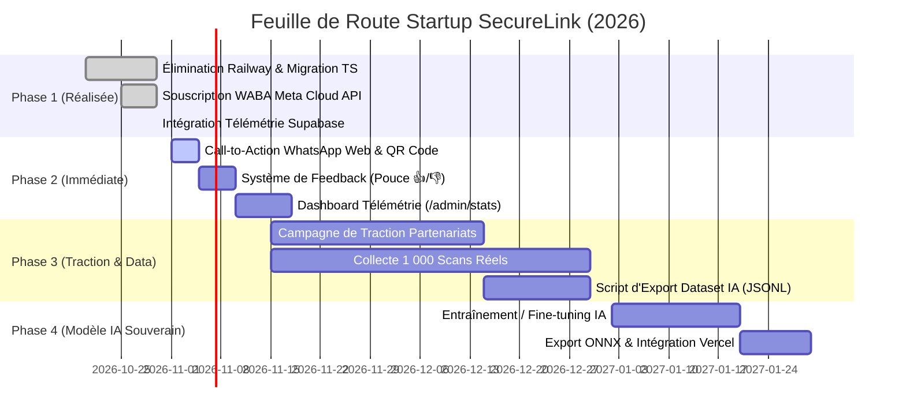

# 🗺️ Plan d'Implémentation & Feuille de Route Startup (Roadmap)
## Projet : SecureLink Maturation & AI Scaling Roadmap
**Version :** 1.0.0  
**Statut :** En cours d'exécution  
**Date de révision :** Octobre 2026  

---

## 1. Cadre Stratégique & Jalons Majeurs (Milestones)

L'objectif de cette feuille de route est de transformer SecureLink d'un prototype fonctionnel en une **plateforme de cybersécurité mature, scalable et monétisable** pour l'Afrique francophone.



---

## 2. Rétrospective : Jalons Déjà Atteints (Phase 1 — 100% Terminée)

- [x] **Élimination complète de la dépendance Railway** : Migration de l'ensemble des 922 lignes de logique Python en TypeScript natif dans `lib/scanner/`.
- [x] **0€ de coût récurrent** : Hébergement 100% gratuit sur Vercel Serverless.
- [x] **Souscription officielle Meta Cloud API** : WABA `2435867747196878` souscrite avec succès avec token système permanent.
- [x] **Pipeline de données Supabase PostgreSQL** : Table `analyses` opérationnelle, enregistrement asynchrone non-bloquant et anonymisation stricte RGPD.

---

## 3. Phase 2 : Maturation Produit & Boucle de Rétroaction (Semaines 1 à 3)

### Tâche 2.1 : Intégration du Bouton WhatsApp et du QR Code sur le Web
- **Objectif :** Guider les visiteurs du site web directement vers le bot WhatsApp `+237 6 56 73 13 63`.
- **Livrables :**
  - Bouton flottant responsive aux couleurs de WhatsApp en bas à droite de l'écran.
  - Section "Scanner sur WhatsApp" sur la page d'accueil avec QR Code généré dynamiquement.
  - Déclencheur direct : `https://wa.me/237656731363?text=Bonjour`.

### Tâche 2.2 : Boucle de Qualification des Données (Feedback 👍 / 👎)
- **Objectif :** Permettre aux utilisateurs de noter l'exactitude du diagnostic.
- **Livrables :**
  - Composant interactif sous la carte de résultat avec deux boutons : *« Ce diagnostic était-il utile ? »*.
  - Enregistrement dans la table `public.feedback` liée à l'analyse pour constituer le "Gold Standard" de l'IA.

### Tâche 2.3 : Tableau de Bord Analytique Interne (`/admin/stats`)
- **Objectif :** Permettre aux fondateurs de suivre l'activité en temps réel.
- **Livrables :**
  - Page protégée affichant le total des messages scannés, la proportion Web vs WhatsApp, les catégories d'arnaques dominantes et les pics horaires.

---

## 4. Phase 3 : Collecte Massive & Structuration du Dataset IA (Mois 2)

### Tâche 3.1 : Script d'Exportation Automatique
- **Livrables :** Script Node.js / TypeScript extrayant les données vérifiées de Supabase vers un fichier structuré `dataset_train.jsonl` :
  ```json
  {"text": "URGENT Votre compte MoMo est bloqué...", "label": "scam", "category": "financial_pressure"}
  ```

### Tâche 3.2 : Partenariats de Sensibilisation
- Diffusion auprès d'associations étudiantes, groupes de veille cybersécurité et relais locaux pour maximiser les tests quotidiens.

---

## 5. Phase 4 : Modèle IA Dédié & Déploiement Local (Mois 3)

### Tâche 4.1 : Entraînement
- Entraînement d'un classifieur de texte adapté au contexte linguistique local (Camfranglais, formulations typiques de transferts).
- Comparaison entre Fine-Tuning Gemini 1.5 Flash et un modèle compact (DistilBERT / MiniLM).

### Tâche 4.2 : Export ONNX & Exécution Edge
- Conversion du modèle entraîné en format `.onnx` léger (< 20 Mo).
- Exécution directe sur Vercel avec `onnxruntime-node` : **analyse IA instantanée sans aucun serveur tiers payant**.

---

## 6. Matrice de Gestion des Risques

| Risque Identifié | Probabilité | Impact | Stratégie d'Atténuation |
| :--- | :---: | :---: | :--- |
| **Dépassement de quota Meta WhatsApp (1 000 conv/mois)** | Faible | Moyen | Les conversations initiées par les utilisateurs avec fenêtre de service client sont très économiques ; passage au palier supérieur lors de la traction. |
| **Faux positifs sur des SMS légitimes d'opérateurs** | Moyenne | Élevé | Système de feedback 👍/👎 + liste blanche stricte des domaines officiels (`mtn.cm`, `orange.cm`). |
| **Panne temporaire de la base Supabase** | Faible | Faible | Architecture "Fire-and-Forget" : le moteur fonctionne même sans base de données. |
| **Fuite de données personnelles d'un utilisateur** | Très faible | Critique | Anonymisation systématique irréversible avant toute écriture disque/DB. |
